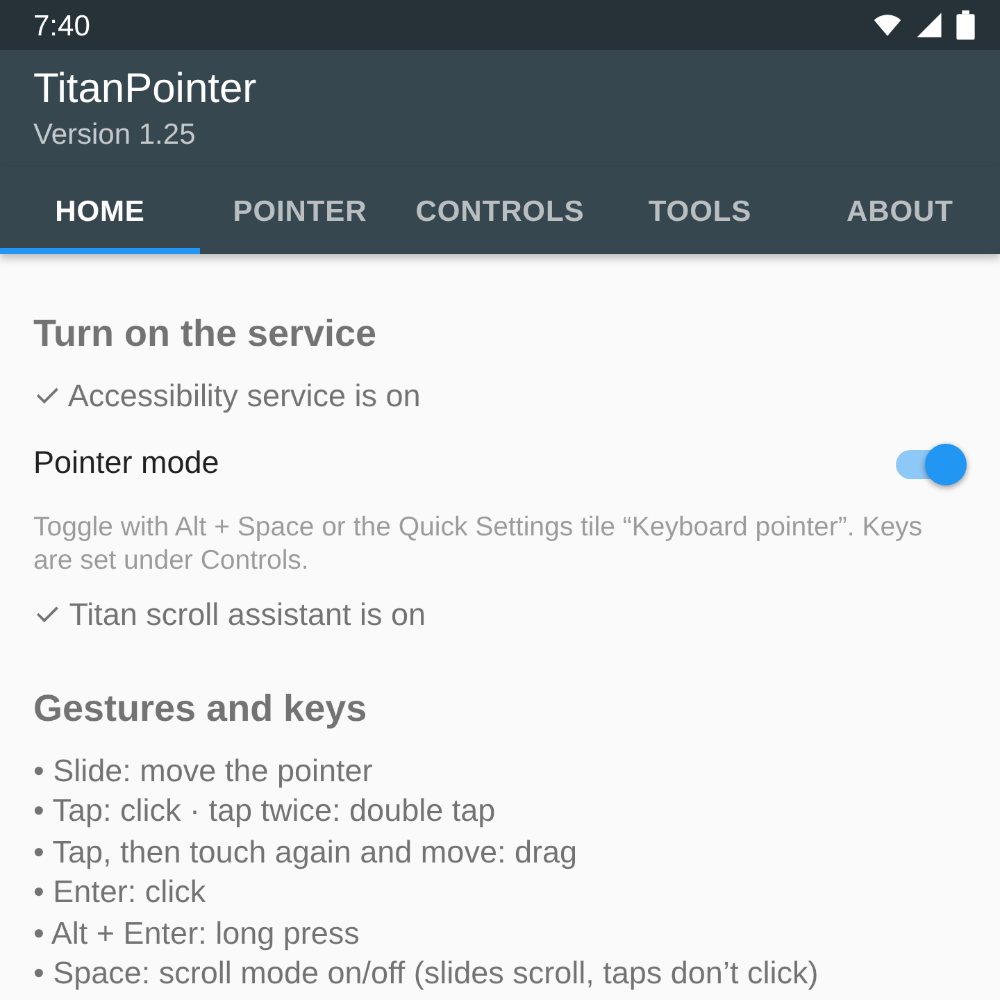
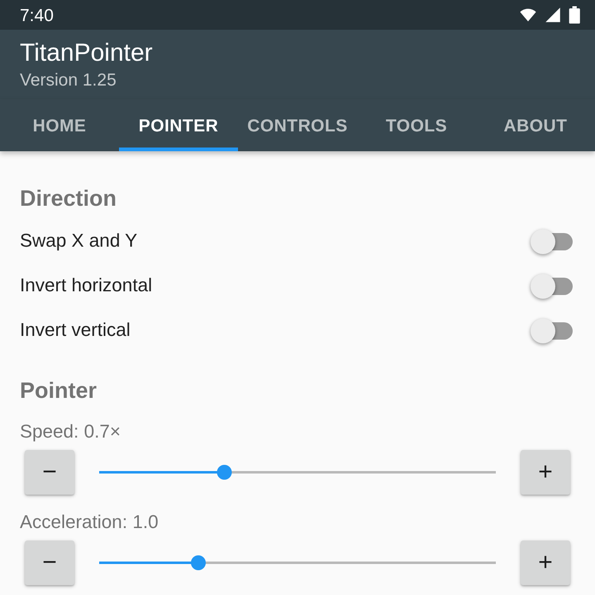
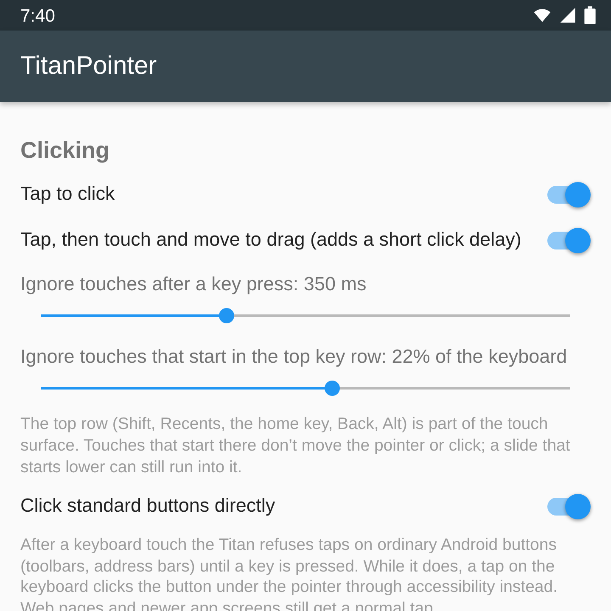
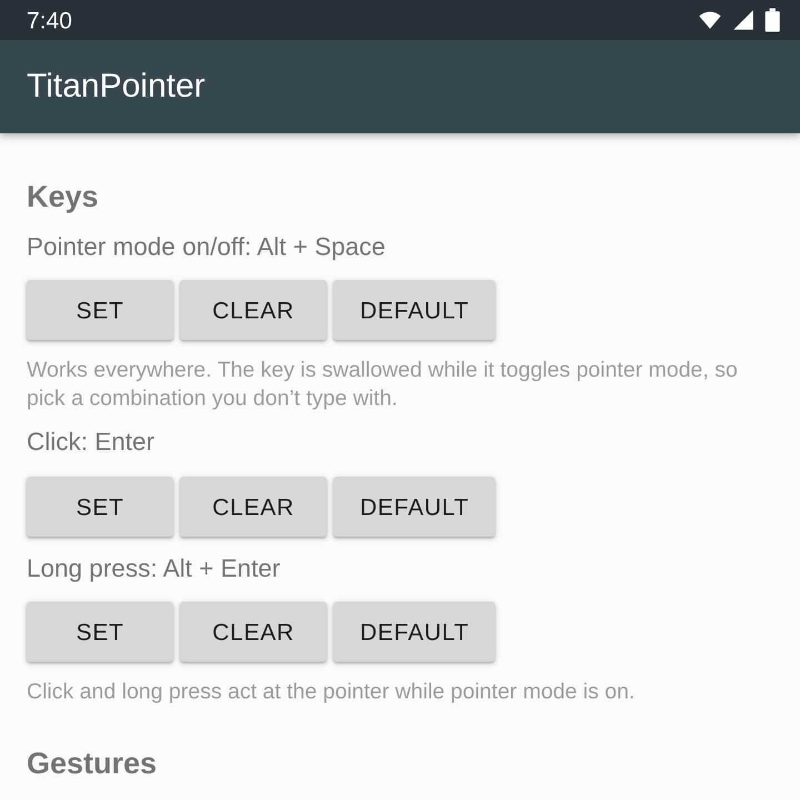

# TitanPointer

Turns the touch-sensitive physical keyboard of the original **Unihertz Titan** (2019) into a laptop-style
touchpad with an on-screen mouse pointer. No root needed.

> **AI-generated code.** All of the code in this repository was written by an AI (Claude, by Anthropic),
> directed and tested by a human on a real Titan. Review it before you trust it with anything important.

<p>
  
  
  
  
</p>

<sub>The settings screen (1.24) at the Titan's 1440 × 1440 resolution, with default settings. These are renderings of
the app's layout (<code>docs/screenshots/</code>, made with <code>node docs/screenshots/render.js</code>), not
captures from a phone.</sub>

## What it does

| On the keyboard | Result |
|---|---|
| Slide | Move the pointer (with acceleration) |
| Tap | Click at the pointer |
| Tap twice | Double tap |
| Tap, then touch again and slide | Drag (press, hold and move at the pointer) |
| Space, then slide | Scroll mode: slides scroll, taps never click |
| Space, then flick | Fling: the page keeps scrolling and slows down (setting) |

| Key (while pointer mode is on) | Action |
|---|---|
| Alt + Space | Pointer mode on/off (works everywhere; changeable) |
| Enter | Click (changeable) |
| Alt + Enter | Long press (changeable) |
| Space | Scroll mode on/off |
| Back | Back, as usual |
| Letters | Nothing by default (setting: turn pointer mode off) |

- The Titan's keyboard reports **one finger** at a time, so there are no multi-finger gestures.
- Touches that start on the top key row (Shift, Recents, home, Back, Alt) are ignored, so pressing those
  keys doesn't click. The cut-off is adjustable.
- Touches during and just after a key press don't move the pointer or click.
- Pointer mode can also be switched with the Quick Settings tile **Keyboard pointer** or the switch in
  the app.

Hardware details (keyboard layout, sensor range, key codes): [docs/titan-hardware.md](docs/titan-hardware.md).

## Keyboard taps on standard Android buttons

On the Titan, a fake tap right after a keyboard touch doesn't click classic Android buttons and toolbars,
including the address bars and toolbar buttons of Firefox and Chrome. Since 1.24, **Click standard buttons
directly** (under Clicking, on by default) works around it: while the phone is blocking taps, a tap on the
keyboard clicks the standard button under the pointer through accessibility (for text fields: focus and
click) instead of sending a fake touch. Web pages and Jetpack Compose screens accept fake taps, so they
still get a normal tap. The click key (Enter) also works everywhere. Not yet confirmed on the phone.

### Why

This is the Titan's own software, not TitanPointer. Its input reader (`libinputreader.so`,
`InputReader::processEventsForDeviceLocked`) sets the system property `debug.sf.forcescroll_view` to `yes` on
every event from the keyboard touch sensor and to `no` on events from any other hardware device (a key, the
touchscreen). While it's `yes`, the Titan's modified `View.onTouchEvent` refuses touches on standard views, so
that keyboard scrolling doesn't press buttons. Fake taps from apps (and even ADB's `input` command) enter
Android after the input reader, so they never reset it: every tap TitanPointer sends after a keyboard tap is
refused by standard views. Only root or `adb shell setprop` can reset the property.

## Titan scroll assistant setting (optional, needs a one-time ADB command)

The collapsed **Titan scroll assistant** section has **Turn the scroll assistant off when pointer mode is off**
(off by default): the keyboard then only scrolls pages while you're using the pointer, and pointer mode turns
it back on (the pointer needs it). To allow it, run this once from a computer after installing:

```sh
adb shell pm grant com.titanpointer android.permission.WRITE_SECURE_SETTINGS
```

The scroll assistant is Settings.Global `touchpad_switch_value` (1 on, 0 off); the phone copies it into
`persist.sys.touchpad_switch`.

## Install

1. Install [`dist/TitanPointer-1.24.apk`](dist/TitanPointer-1.24.apk).
2. Open **TitanPointer** and turn on its accessibility service (Settings → Accessibility → TitanPointer).
   It draws the pointer, sends taps and swipes at the pointer, and reads key presses for the shortcuts.
   Nothing is collected or sent anywhere.
3. Keep the Titan's keyboard scrolling (scroll assistant) turned on: without it the keyboard touches don't
   reach TitanPointer.
4. Press **Alt + Space** and slide on the keyboard.
5. Optional: to have the keyboard stop scrolling pages while pointer mode is off, run the `pm grant`
   command [above](#titan-scroll-assistant-setting-optional-needs-a-one-time-adb-command) once.

The app shows a minimal, silent notification while the service runs. It keeps Android from stopping the
service when you swipe the app away; you can hide it in the notification settings.

## How it works (no-root mode)

The Titan's keyboard sensor shows up to apps as its own touchpad device (`mtk-pad`, 1440×720, absolute
positions), and Android only sends its events to the window with keyboard focus. While pointer mode is on,
TitanPointer keeps a tiny invisible window focused (screen touches pass straight through), turns the
touches into pointer movement, and injects taps and swipes through the accessibility service.

Because that window holds keyboard focus, keys can't reach the app underneath while pointer mode is on:
turn it off (Alt + Space) to type. While pointer mode is on, the keyboard app (e.g. BlackBerry Keyboard)
is hidden and the text field loses focus, because otherwise the keyboard app receives the keyboard touches
instead. Both are restored when you turn pointer mode off.

If the pointer stops working somewhere, open the **Diagnostics** section at the bottom of the app
(collapsed, and off by default), turn on **Capture diagnostics**, reproduce the problem and copy the log. It
records focus changes, windows, keys and every click: where it went, what was under the pointer and what
the app did with it. The section also has a tap test screen and a search of the phone's own software that
were used to track down the limitation above.

## Root and ADB modes (untested)

> **These modes have never been tested on a real device.** They're there for anyone who wants to try
> typing with the pointer on at the same time.

A small native helper ([`native/titanpad.c`](native/titanpad.c)) reads the sensor's `/dev/input/eventN`
device directly, so keys keep working while the pointer is on. Choose it in the collapsed **Advanced: root /
ADB (untested)** section at the bottom of the app. It needs either:

- **Root (Magisk):** choose *Root* in the app and approve the su prompt.
- **ADB:** choose *ADB helper*, enable USB debugging, and after every reboot run the command shown in the
  app from a computer (or `scripts/start-adb-helper.sh <token shown in the app>`). The helper listens only
  on `127.0.0.1` and rejects clients without the app's random token.

**Exclusive access** makes the helper grab the device (`EVIOCGRAB`) so Android stops reacting to the
swipes too. **Calibrate area** limits the pointer to part of the device.

## Build

Requirements: JDK 17+, the Android SDK (platform 34), and `aarch64-linux-gnu-gcc` (only to rebuild the
helper).

```sh
./gradlew testDebugUnitTest  # gesture engine and diagnostics unit tests
./gradlew assembleRelease    # app/build/outputs/apk/release/app-release.apk
native/build.sh              # rebuild the helper into app/src/main/jniLibs/arm64-v8a/libtitanpad.so
```

Builds are signed with `signing/titanpointer.keystore`, a throwaway key kept in the repo so every build
can update an installed copy. Use your own key if you distribute it.

## Code layout

```
app/src/main/java/com/titanpointer/
  PointerService     accessibility service: pointer overlay, focus window, keys, injected gestures
  GestureEngine      single-finger touchpad gestures (unit tested)
  GestureInjector    taps, long presses and continued strokes via dispatchGesture()
  MainActivity       setup and settings screen
  ElementClick       clicks the standard View under the pointer while the Titan blocks fake taps
  ScrollAssist       switches the Titan's scroll assistant (needs WRITE_SECURE_SETTINGS via ADB)
  Diag               in-app diagnostics log (off by default)
  ClickTrace         per-click diagnostics: timing, what's under the pointer, the app's response
  TapTestActivity, StateProbe, FrameworkScan   tools used to find the Titan's tap block
  PadLink, TouchTracker, native/titanpad.c   root/ADB path (untested)
```
